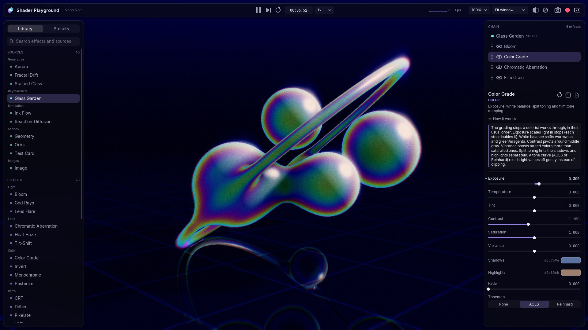

# Shader Playground

A LÖVE 11.5 workbench for building, stacking and tweaking GLSL effects, and
a small gallery of what shaders can do.



More renders and clips: [chaps.dev/projects/shaderplayground](https://chaps.dev/projects/shaderplayground/)

Pick a **source** (a generative shader, a Lua-drawn scene, or any image you
drop on the window), stack **effects** on top, and shape every parameter with
sliders, color pickers and XY pads. Shaders are plain `.glsl` files that
reload the moment you save them. Looks can be saved as presets, captured as
PNGs, or recorded to GIF/MP4.

```
love .                 # run
lovec . --selftest     # compile everything, render every shader + preset, exit 0/1
```

Press **G** for gallery mode: a slow, captioned slideshow of the curated
presets.

## What's inside

**Sources**: Aurora · Glass Garden (raymarched) · Fractal Drift ·
Reaction-Diffusion · Ink Flow · Stained Glass · Orbs · Geometry · Test Card ·
Image (three NASA photos bundled; drop your own)

**Effects**: Bloom · God Rays · Lens Flare · Chromatic Aberration · Tilt-Shift ·
Heat Haze · CRT · VHS · Dither (Game Boy, PICO-8, CGA…) · Pixelate ·
Kuwahara · Halftone · ASCII · Toon · Paper · Edge Detect · Color Grade ·
Monochrome · Posterize · Invert · Wave · Kaleidoscope · Radial Blur · Glitch ·
Feedback Trails · Motion Smear · Film Grain · Vignette

Every shader has a short **How it works** note in the inspector, explaining
the idea behind it.

## Controls

| | |
|---|---|
| Click a library entry | Use as source / add effect after the selection |
| Drag a library effect | Drop it at a position in the chain |
| Hover a library entry | Live preview on your current image |
| Drag a chain row | Reorder |
| Slider | Drag · **Shift** fine · **Ctrl** snap · **double-click** type a value · **right-click** reset |
| Drag on the image | Sets `iMouse` (orbit Glass Garden, seed Reaction-Diffusion, stir Ink Flow…) |
| **A / D**, **← / →** | Swap the selected slot for the previous / next library entry |
| **W / S**, **↑ / ↓** | Select a param · **Q / E**, **− / =**, mouse wheel over the image: adjust it |
| **[ / ]** | Select previous / next chain node |
| **B** · **Delete** · **Ctrl+↑/↓** | Bypass node · remove node · move node |
| **R** · **Shift+R** · **X** | Reset params · restart simulation · randomize |
| **Space** | Bypass all effects |
| **C** | Before/after compare (drag the divider) |
| **P** · **.** | Pause · step one frame |
| **F12** · **Shift+F12** | Screenshot (output only · with UI) |
| **F9** | Start/stop recording |
| **Ctrl+S** | Save preset |
| **F5** | Reload all shaders |
| **G** | Gallery mode (any key exits) |
| **Tab** · **F11** · **F3** | Hide UI · fullscreen · debug overlay |
| **1–4** | Orbs · Geometry · Image · Test Card |
| **Esc** | Quit (the session is restored next launch; `--fresh` to skip) |

## Writing shaders

Drop a `.glsl` file into `shaders/effects/` (or `shaders/sources/`). It shows
up within two seconds and reloads every time you save. Compile errors appear
in the inspector with the exact `file:line`, even inside included files, and
the last working version keeps rendering.

```glsl
// @name Chromatic Aberration
// @category Lens
// @desc One-line summary shown in the library
// @about A longer "how it works" note shown in the inspector.
// @about Repeat @about lines to continue the paragraph.

uniform float strength; // default=0.008 min=0 max=0.05 step=0.0005 tip="Hover help"
uniform vec3  tint;     // color default=#ffd9a0
uniform vec2  center;   // xy default=0.5,0.5
uniform float angle;    // angle default=0
uniform float zoom;     // default=1 min=0.2 max=4 log
uniform int   mode;     // enum=Radial,Directional default=Radial
uniform bool  glow;     // default=true

vec4 effect(vec4 color, Image tex, vec2 uv, vec2 sc) {
    return Texel(tex, uv) * color;
}
```

The GLSL type picks the widget. An optional first word changes it: `color`,
`xy`, `vec`, `angle` (shown in degrees), `log`, or `hidden`. Use `label=` to
rename a param in the UI. Everything compiles as GLSL 3.30
(`#pragma language glsl3` is added for you).

**Automatic uniforms** (declared in `shaders/lib/prelude.glsl`; don't redeclare them):

| | |
|---|---|
| `iTime`, `iTimeDelta`, `iFrame` | Clock (fixed-step while recording). `iFrame` restarts with the node |
| `iResolution` | Output size of this pass; `.z` = aspect |
| `iTexel` | 1 / size of this pass's input |
| `iMouse` | `.xy` last point dragged on the image (uv), `.z` button held |
| `iSource`, `iInput` | The source image, and this node's input |
| `iFeedback` | This node's own output from the last frame (using it enables feedback) |
| `iPrev` | This pass's previous frame (persist passes) |

Helpers: `luma()`, `centered(uv)`, `PI`, `TAU`. Include more with
`#include "lib/noise.glsl"` (hashes, gradient noise, fbm, voronoi, curl),
`lib/blur.glsl`, `lib/color.glsl` (cosine palettes, ACES, HSV), and
`lib/sdf.glsl`.

**Multi-pass**: split a file with `//@pass` lines. Code above the first pass
is shared by all passes. Later passes read earlier ones by name:

```glsl
//@pass bright in=input scale=0.5
...
//@pass blurH in=bright scale=0.5
...
//@pass composite in=input
uniform Image blurH;   // the earlier pass's output
```

Pass options: `in=input|none|self|<pass>`, `scale=`, `format=rgba8|rgba16f|rgba32f`,
`persist` (keeps its buffer between frames), `iterations=N`,
`filter=nearest`, `wrap=repeat|mirroredrepeat`. `in=self` makes a
simulation: see `shaders/sources/reaction_diffusion.glsl`.

**Lua sources** live in `src/sources/lua/` and hot-reload the same way. Each
returns `{ name, category, desc, about, params, new(), update(), draw() }`;
see `orbs.lua`.

## Presets, capture and files

- **Presets** are Lua table files in `presets/` (sorted keys, diff-friendly).
  Saving from the app writes into the project folder when running from
  source. Set `gallery = true` to include a preset in gallery mode.
- **Captures** go to the LÖVE save folder:
  `%APPDATA%/LOVE/ShaderPlayground/captures`. Click a toast to open it.
  Recording runs on a fixed 30 fps clock. If `ffmpeg` is on your PATH you get
  `recording.mp4` and a palette-optimized `recording.gif`; otherwise a PNG
  sequence.
- **Output size**: *Fit window* or a fixed 720p / 1080p / square / portrait
  size. **Render scale** trades sharpness for speed on heavy shaders.

## Testing

```
lovec . --selftest                                                   # parser, serializer, every shader & preset
lovec . --fresh --preset 02_neon_noir --script tests/ui_smoke.lua    # drives the real UI with a virtual mouse
lovec . --fresh --script tests/hot_reload.lua                        # live file edits, error line mapping
lovec . --fresh --preset 05_deep_field --script tests/capture.lua    # screenshot + recording + ffmpeg
```

Or run them all with `bash tests/run_all.sh`. Scripts are lists of timed
steps (`click`, `drag`, `key`, `text`, `check`, `shot`) that target widgets
by id. See `src/script.lua`. Flags must come *after* the path: LÖVE treats
its first argument as the game folder.

## Layout

```
main.lua               callback forwarding (+ --selftest)
src/app.lua            state, actions, input routing, shortcuts
src/shaderlib/         parse → compose → compile, registry + hot reload
src/render/            pipeline, nodes, canvas pool
src/ui/                immediate-mode UI core, widgets, panels, hover preview
src/presets.lua        presets + session autosave
src/capture*.lua       threaded PNG/TGA encoding, ffmpeg
shaders/               lib/, sources/, effects/
libs/                  LoveLibs (git subtree): settings + debug overlay are used
```

Fonts: Inter and JetBrains Mono (SIL OFL, licenses in `assets/fonts`).
Sample photos: NASA (see `assets/images/CREDITS.md`).
